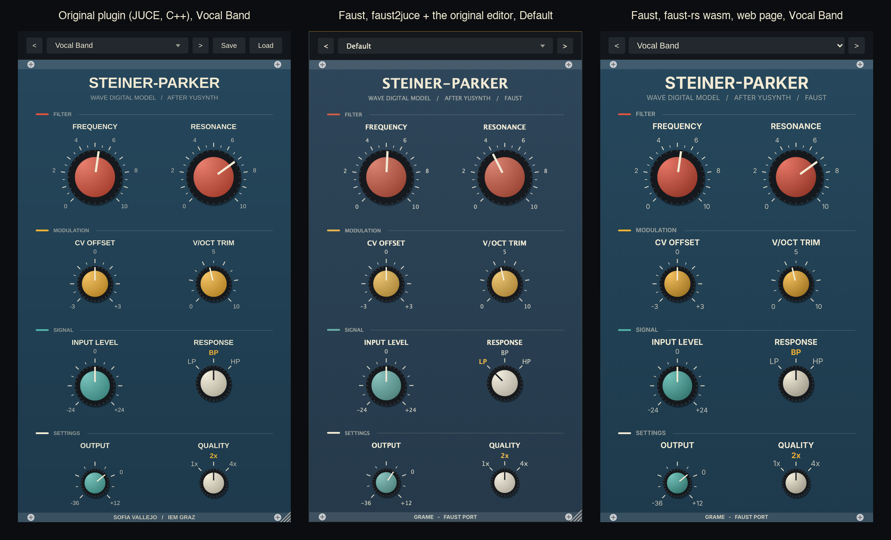

# faust-steiner-parker

**Le filtre Steiner-Parker de Sofia Vallejo, un modèle d'ondes numériques non linéaire du VCF Steiner-Parker de Yusynth, écrit en Faust, vérifié échantillon par échantillon contre le C++ du plugin lui-même, et construit en plugin JUCE (faust2juce) et en page web (faust-rs, WebAssembly) avec la façade d'origine.**

*English version: [README.md](README.md).* · **L'essayer dans le navigateur : https://sletz.github.io/faust-steiner-parker/**

L'[original](https://github.com/sofiavallejob/steiner-parker-filter) (AGPL-3.0, Institut für Elektronische Musik und Akustik, KUG Graz ; [article](https://sofiavallejob.github.io/sofiavallejo/blog/steiner-parker-filter/)) modélise la réalisation Eurorack Vult (L. Laguna Ruiz, 2017) du VCF Steiner-Parker « amélioré » de Yusynth, d'après le Synthacon de Nyle Steiner. Il existe sous trois formes : une référence Python, un modèle C++ (`plugin/Source/SPModel.h`, 319 lignes) dans un plugin JUCE, et un JSFX pour Reaper :

- les six condensateurs sont des feuilles d'ondes numériques (Rc = T/2C, b[n] = a[n−1]) ;
- tout le reste, 11 nœuds (l'échelle de diodes, la paire exponentielle THAT300, les étages TL074 avec leur coude de saturation, la boucle de résonance), forme une seule racine non linéaire réduite à 5 ports, quatre groupes de diodes fusionnés et le courant de contre-réaction, résolue par Newton à chaque échantillon avec la limitation de jonction de SPICE (`pnjlim`), la boucle de résonance à l'intérieur de la résolution et non coupée par un retard ;
- l'état part du point de fonctionnement continu ; le plugin ajoute un lissage des contrôles de 5 ms, un suréchantillonnage 1x/2x/4x, un étage de sortie (×22, coude de saturation) et 8 préréglages d'usine.

Ce dépôt est le même modèle en Faust, [dsp/steinerparker.lib](dsp/steinerparker.lib), et ce qu'il a mesuré :

- **il reproduit le C++** : le circuit seul concorde avec `SPModel.h` à 5e-8 V sur les entrées A et B et 2e-7 V sur l'entrée C (crêtes de 0,6 à 0,9 V), toute la chaîne du plugin à −115 dB de la crête au pire sur les réglages par défaut, les 8 préréglages d'usine et 1x/2x/4x ; à titre de comparaison, l'original rapporte 0,8 µV entre son C++ et son Python, 1,4 µV entre son JSFX et son Python ([results/results.md](results/results.md)) ;
- **il coûte ce que coûte le C++**, compilé par faust-rs avec une boucle de Newton qui sort comme celle du C++ : 27,1 fois le temps réel en stéréo en 2x contre 26,4 pour l'original, 10,4 contre 9,2 en 4x, même machine, même compilateur et mêmes options (§4). La forme qu'accepte n'importe quel compilateur Faust, la boucle déroulée sur 12 itérations, est 3 à 4,6 fois plus lente ;
- les matrices nodales et leur inverse ne sont pas précalculées : le programme Faust construit la netlist et l'inverse lui-même, par Gauss-Jordan écrit sur des bus, pour les trois entrées à la fréquence de l'hôte, une fois à l'initialisation ;
- **il tourne en plugin JUCE** (AU, VST3, Standalone) construit par faust2juce avec la façade d'origine (l'éditeur du plugin, adapté au processeur Faust) et les 8 préréglages comme programmes de l'hôte, et **en page web** compilée en WebAssembly par faust-rs, la même façade en SVG, la qualité commutable.

<p align="center"></p>

## Sommaire

1. [Le portage](#1-le-portage)
2. [Les deux formes de la boucle de Newton](#2-les-deux-formes-de-la-boucle-de-newton)
3. [Résultats](#3-résultats)
4. [Coût CPU](#4-coût-cpu)
5. [Le plugin JUCE et la page web](#5-le-plugin-juce-et-la-page-web)
6. [Utilisation](#6-utilisation)
7. [Pourquoi pas `wdmodels.lib`](#7-pourquoi-pas-wdmodelslib)
8. [Ce qui diffère de l'original](#8-ce-qui-diffère-de-loriginal)
9. [Fichiers](#9-fichiers)

## 1. Le portage

**Netlist.** `nodal(dest, fs)` écrit la matrice de conductance 11 × 11 de `Circuit::build`, repères des composants conservés, pour l'entrée `dest` (A passe-bas, B passe-bande, C passe-haut), avec les conductances des condensateurs 2 fs C ; `fs = 0` laisse les condensateurs ouverts et donne la matrice du continu. Chaque coefficient est une somme de contributions dont les indices de nœuds sont des entiers connus à la compilation : les zéros structurels disparaissent.

**L'inversion dans le programme.** `inverse(n)` est Gauss-Jordan sur [A | I], `n` étapes de `gj_step`, chacune une `route` qui donne à chaque élément les quatre valeurs dont il a besoin (a_ij, a_ik, a_kj, a_kk) puis un `par` arithmétique : le programme grandit avec la matrice (11 étapes de 242 éléments), pas avec les usages de ses coefficients. Pas de pivot : la matrice nodale est symétrique et à diagonale dominante. `coefs(dest, fs)` forme ensuite les 165 coefficients de la racine (K, Au, Ac et Wc de `Circuit::reduce` et `precompute`), chacun une forme bilinéaire (e_a − e_b)ᵀ Gi (e_c − e_d) lue dans l'inverse. Ils ne dépendent que de `ma.SR` : le compilateur les calcule une fois à l'initialisation ; les trois entrées sont calculées et choisies par le contrôle Response (un changement remet l'état au point continu, comme le `reconfigure` du plugin). Ils concordent avec ceux du C++ à 2e-14 près en relatif.

**La racine.** `newton_step` est une itération sur les 5 ports : courants de diodes linéarisés au-delà de 40 tensions thermiques, courant de contre-réaction à travers le coude de saturation, F(u) = u − u0 + K i(u), J = I + K diag(i′(u)), le système 5 × 5 résolu par Gauss-Jordan (le JSFX ne pivote pas non plus ; le pivot partiel du C++ n'échange jamais de ligne sur aucun réglage mesuré : le retirer laisse sa sortie identique au bit près), `pnjlim` sur les ports de diodes, et un gel dès qu'un pas est sous 1e-9 V. `tick` est un échantillon : u0 = Au z avec z = [1, vs, i1, i2, b], la boucle de Newton, les ondes b ← 2 v − b, et Vo1 à travers le coude de saturation.

**Le point continu.** `dc_state` exécute le même `tick` sur les coefficients du continu, à partir de u = (0,5, 0,5, 0,5, 0,5, 0), avec 40 itérations (le C++ en demande jusqu'à 32 sur les plages des contrôles) ; il ne dépend que des contrôles, il est donc calculé à la fréquence des contrôles, et l'état le prend au premier échantillon, à un changement d'entrée, et dès que l'état cesse d'être fini.

**La chaîne du plugin** est celle de l'original : contrôles lissés sur 5 ms et appliqués une fois par échantillon de l'hôte, 1,0 = 5 V à l'entrée, le tampon inverseur IC1A, le suréchantillonnage avec les filtres anti-repliement du JSFX (deux biquads RBJ à 0,45 de la fréquence de l'hôte de chaque côté, l'entrée sur le premier sous-échantillon), l'étage de sortie, le gain de sortie.

## 2. Les deux formes de la boucle de Newton

Le C++ itère jusqu'à un pas sous 1e-9 V, au plus 50 fois : 2 itérations sur 95 % des échantillons, jusqu'à 13 à résonance maximale avec +24 dB de drive. Faust n'a pas de boucle ; la bibliothèque prend donc la boucle en argument de `tick_with` :

- **`repeated(H)`**, la boucle du C++, sortie comprise. Elle repose sur [dsp/repeat.lib](dsp/repeat.lib) (de [faust-diff-ts808](../faust-diff-ts808)), la simulation de la primitive `repeat` par les domaines d'horloge `ondemand` de faust-rs : un échantillon coûte les itérations dont il a besoin. faust-rs seulement (faustprobe, `faust-rs -lang cpp`, `-lang wasm`) : `dsp/steinerparker_rs*.dsp`.
- **`unrolled(N)`**, pour n'importe quel compilateur Faust (le compilateur Faust C++, donc faust2juce) : N itérations calculées à chaque échantillon, gelées une fois convergées. L'itéré est celui du C++ tant que N couvre ce dont l'échantillon a besoin ; N = 12 est le plus petit budget qui reproduit le C++ sur tous les réglages mesurés (N = 3 suffit déjà sur tous les réglages ordinaires ; les réglages extrêmes en demandent 12). `dsp/steinerparker*.dsp`.

Les deux formes donnent les mêmes échantillons (le plus grand écart entre elles sur toute la suite figure dans la table de [results/results.md](results/results.md)) ; elles ne diffèrent que par leur coût.

## 3. Résultats

Tout est dans [results/results.md](results/results.md), écrit par `make test` avec les lignes de commande, les versions de chaque outil (commit de faust-rs compris) et la machine. Chaque sortie Faust est comparée au modèle original, `ref/SPModel.h` inchangé, piloté par [ref/sp_ref.cpp](ref/sp_ref.cpp) (le circuit seul comme le `model_test` de l'original, ou la chaîne du plugin du JSFX).

- **Circuit seul**, une dent de scie de 110 Hz à 5 V à 192 kHz comme dans `model_test`, 0,125 s : 4,9e-8, 5,2e-8 et 1,9e-7 V sur les entrées A, B et C (crêtes de 0,63 à 0,90 V) ; celui de l'entrée C croît avec le décalage lent décrit plus bas.
- **Chaîne du plugin**, une dent de scie de 55 Hz à 48 kHz, 2 s : −115 à −131 dB de la crête aux réglages par défaut en 1x/2x/4x, aux réglages passe-bande et passe-haut, filtre fermé, aux extrêmes de CV et de trim, et sur 7 des 8 préréglages.
- **D'où vient l'accord.** Les deux points continus diffèrent d'environ 1e-9 V (la matrice du continu s'étend de 1e-12 à 1e-3 S : GMIN sur les nœuds flottants de l'échelle), et cet écart est déjà dans le premier échantillon. Ce n'est ni la tolérance de Newton (le C++ à 1e-9 et à 1e-13 diffère de −201 dB) ni le pivot.
- **Un décalage lent.** Aucun des deux points continus n'est exactement l'équilibre de son système discret : sans entrée, chaque implémentation s'écarte du sien jusqu'à 2e-7 V sur Vo1 en quelques secondes (le pôle lent de C12 et R14, 1,5 s), et elles se stabilisent à 1,6e-7 V (entrée A) et 1,8e-7 V (entrée C) l'une de l'autre à 48 kHz, avec ou sans signal : un décalage continu à −135 dB du signal. Sa cause n'est pas identifiée (il ne bouge pas non plus avec la tolérance de Newton) ; il croît avec la fréquence d'échantillonnage (à 192 kHz il atteint 1e-6 V après une seconde, encore croissant), d'où la tolérance de 5e-7 V du contrôle du circuit, 0,125 s à 192 kHz.
- **Réglages chaotiques.** Le préréglage « Self-oscillation » (résonance 0,97, 4x) oscille à partir du bruit d'arrondi : le C++ lui-même bouge de +6 dB quand son entrée est multipliée par 1 + 1e-9, et les deux canaux du programme Faust, alimentés par la même entrée, diffèrent d'autant. À résonance maximale avec +24 dB de drive, les écarts croissent aussi, plus lentement. Là, la suite compare le niveau et le centroïde spectral à la dispersion des exécutions perturbées du C++, et le programme Faust y reste.
- **Le contrôle rejette ce qu'il doit** : changer R6 de 1 % dans la netlist Faust fait échouer 20 contrôles (−66 dB), le changer de 1 Ω (21 ppm) en fait échouer 5.
- **Les autres back-ends** : le C++ généré par le compilateur Faust C++ et par faust-rs, et le wasm de la page web exécuté sous node par le chargeur de la page, concordent avec faustprobe à −114 dB ou mieux.

## 4. Coût CPU

Stéréo, 48 kHz, une dent de scie de 55 Hz, réglages par défaut, l'appel `compute` seul chronométré, meilleur de trois exécutions ; les deux programmes C++ construits avec Apple clang 21 `-O3 -ffp-contract=off`, Apple M5 ([results/results.md](results/results.md), `make cost`) :

| qualité | C++ original | Faust, C++ de faust-rs, `repeated` | Faust, C++ de faust-rs, `unrolled(12)` | Faust, C++ de faust (C++), `unrolled(12)` | Faust, wasm (node) | Faust, JIT de faustprobe, `repeated` |
|---|---|---|---|---|---|---|
| 1x | 52.4x | 53.7x | 11.3x | 11.2x | 19.3x | 25.8x |
| 2x | 26.4x | 27.1x | 5.7x | 6.1x | 10.2x | 13.5x |
| 4x | 9.2x | 10.4x | 2.9x | 3.0x | 4.4x | 5.4x |

(facteurs de temps réel ; l'article de l'original rapporte « environ 7 fois plus rapide que le temps réel » en 2x stéréo sur sa machine.)

- Avec la boucle qui sort, le programme Faust coûte ce que coûte le C++ : 1,02 fois sa vitesse en 1x, 1,03 en 2x, 1,13 en 4x (deux exécutions du même programme diffèrent de 10 à 20 % : d'où le meilleur de trois).
- La forme déroulée paie 12 itérations là où le C++ en paie 2 à 3 : 3 à 4,6 fois le coût. C'est aujourd'hui le prix de faust2juce, puisque le compilateur Faust C++ n'a ni `ondemand` ni `repeat`.
- Dans le navigateur (le panneau de l'application Claude, Chromium), l'AudioWorklet mesure 8,8 % du temps audio en 2x à 48 kHz, 21,7 % en 4x.

## 5. Le plugin JUCE et la page web

**JUCE.** `make juce` lance faust2juce avec `-presets juce/presets.json` (les 8 préréglages d'usine comme programmes de l'hôte, après l'entrée « Default » de l'architecture) et construit le projet CMake généré avec `-DFAUST_CUSTOM_EDITOR=juce/SteinerParkerEditor.h` : la façade du plugin original, son apparence, ses boutons, graduations, couleurs et sa disposition, reprises de `PluginEditor.{h,cpp}` et reliées aux paramètres hôte du processeur Faust. La qualité est fixée à la compilation d'un programme Faust : le plugin affiche le facteur avec lequel il a été construit (`make juce QUALITY=4` construit celui en 4x) et le sélecteur Quality ne tourne pas ; l'enregistrement et le chargement de fichiers de préréglages sont laissés de côté. CMake télécharge JUCE 8.0.10 la première fois (l'éditeur demande JUCE 8).

**Web.** `make web` compile `dsp/steinerparker_rs{,_1x,_4x}.dsp` en wasm (double précision) avec faust-rs, et [web/](web/) les joue dans un AudioWorklet : la façade dessinée en SVG avec la géométrie et les couleurs de l'original (glisser, molette, flèches du clavier, double clic pour revenir au défaut, étiquettes des sélecteurs cliquables), la barre de préréglages, et un banc d'essai (une dent de scie à 1,0 = 5 V, du bruit, un fichier audio ou le micro, le balayage lent de la coupure des exemples d'écoute de l'article, un indicateur de charge CPU). Quality commute entre les trois programmes et remet l'état au point continu, comme le fait le plugin. `make web-serve`, puis <http://localhost:8765/web/>. La version publiée est à https://sletz.github.io/faust-steiner-parker/ : `web/` tel qu'il est sur `main`, avec les modules wasm de `web/dsp`, déployé par `.github/workflows/pages.yml` (rien n'y est compilé ; après un changement de faust-rs, lancer `make -B web` et committer).

## 6. Utilisation

```sh
make test         # tous les contrôles et le coût CPU : results/results.md (une quinzaine de minutes)
make quick        # les contrôles sur des rendus plus courts, sans chronométrage (deux minutes environ)
make check        # chaque programme compile (faustprobe ; les déroulés aussi avec faust)
make cost         # le coût CPU seul
make web          # web/dsp/*.wasm
make web-serve    # http://localhost:8765/web/
make juce         # build/juce/steinerparker-2x/build/steinerparker_artefacts/Release/{AU,VST3,Standalone}
```

Prérequis : un dépôt [faust-rs](https://github.com/grame-cncm/faust-rs) à côté de celui-ci (`FAUST_RS=...` sinon) avec `faustprobe` et `faust-rs` construits en release (`cargo build --release -p cranelift-ffi --bin faustprobe`, `cargo build --release -p compiler --bin faust-rs`) ; le compilateur Faust C++ avec `faust2juce` pour le plugin JUCE ; python3 avec numpy ; node pour le contrôle du wasm ; CMake et Ninja pour JUCE.

Dans un autre programme :

```faust
sp = library("steinerparker.lib");
process = sp.plugin(2, 12, 40);                    // n'importe quel compilateur Faust
process = sp.plugin_with(2, sp.repeated(50), 40);  // faust-rs : la boucle sort
```

Compiler en double précision (`-double`) : le système du continu couvre neuf décades de conductance et la tolérance de Newton est de 1e-9 V.

## 7. Pourquoi pas `wdmodels.lib`

La [wdmodels.lib](https://github.com/grame-cncm/faustlibraries/blob/master/wdmodels.lib) des bibliothèques Faust construit des filtres d'ondes numériques comme des arbres de connexion d'adaptateurs, avec au plus un élément non adapté à la racine, résolu sous forme close ou par une itération scalaire (une paire de diodes par la fonction oméga de Wright), et des adaptateurs de type R à partir d'une matrice de diffusion fournie par l'utilisateur. Ce modèle sort de ce cadre :

- la racine a **cinq** ports non linéaires couplés par un réseau de 11 nœuds (quatre groupes de diodes et un courant de contre-réaction commandé), résolus ensemble par un Newton à 5 dimensions avec limitation de jonction : pas une non-linéarité à un port à la racine d'un arbre ;
- sa partie linéaire n'est pas donnée comme une matrice de diffusion : c'est l'inverse de la matrice nodale avec les conductances des condensateurs, qui dépend de la fréquence d'échantillonnage et de l'entrée choisie ; la calculer est l'essentiel du travail, et la bibliothèque le fait dans le programme ;
- l'état doit partir du point de fonctionnement continu (C7 fait 47 µF : en partant de zéro, le filtre passerait des dizaines de millisecondes à se stabiliser, et ne pourrait pas être comparé au C++ échantillon par échantillon) ; les éléments de `wdmodels.lib` partent de zéro.

Ce qu'elle pourrait porter, les six feuilles condensateurs (b[n] = a[n−1]), tient ici en deux lignes du `tick`. Un Steiner-Parker simplifié, une non-linéarité de diodes à la racine d'un arbre d'adaptateurs, serait un programme naturel pour `wdmodels.lib`, mais ce serait un autre modèle que celui que ce dépôt reproduit.

## 8. Ce qui diffère de l'original

- **Filtres de suréchantillonnage** : le plugin JUCE utilise le suréchantillonneur demi-bande IIR polyphase de JUCE ; ce portage, et son moteur de rendu de référence, utilisent les filtres du JSFX (deux biquads de chaque côté). Le programme Faust est comparé à cette chaîne.
- **Quality** est un choix de compilation en Faust : trois programmes, commutés par la page web ; fixe dans une construction faust2juce.
- **Newton** : pas de pivot dans la résolution 5 × 5 (jamais utilisé par le C++) ; dans la forme déroulée, au plus 12 itérations.
- **Reprise** : le programme Faust remet son état au point continu dès que l'état n'est plus fini, à l'échantillon ; le plugin C++ efface le bloc et se reconfigure.
- **Non porté** : les fichiers de préréglages (Save/Load), l'option de somme mono du JSFX, la simple précision.

## 9. Fichiers

| fichier | |
|---|---|
| [dsp/steinerparker.lib](dsp/steinerparker.lib) | le modèle : outils de bus (Gauss-Jordan, résolution, produit matrice-vecteur), netlist, coefficients, Newton (deux formes), point continu, contrôles, chaîne du plugin |
| [dsp/steinerparker.dsp](dsp/steinerparker.dsp), `_1x`, `_4x` | le plugin, Newton déroulé (n'importe quel compilateur Faust, faust2juce) |
| [dsp/steinerparker_rs.dsp](dsp/steinerparker_rs.dsp), `_1x`, `_4x` | le plugin, Newton avec sortie (faust-rs, web) |
| [dsp/sp_core.dsp](dsp/sp_core.dsp) | le circuit seul, comme le `model_test` de l'original |
| [dsp/repeat.lib](dsp/repeat.lib) | la boucle `repeat` sur `ondemand`, de faust-diff-ts808 (MIT) |
| [ref/SPModel.h](ref/SPModel.h) | le modèle C++ original, inchangé (AGPL-3.0, commit `ed91b4ab` du 2026-11-04) |
| [ref/sp_ref.cpp](ref/sp_ref.cpp) | moteur de rendu de l'original : circuit seul, chaîne du plugin, chronométrage |
| [scripts/test_sp.py](scripts/test_sp.py) | tous les contrôles ; écrit [results/results.md](results/results.md) |
| [scripts/web_check.mjs](scripts/web_check.mjs) | le wasm sous node : rendu, chronométrage |
| [tools/bench_arch.cpp](tools/bench_arch.cpp) | fichier d'architecture pour le chronométrage et le rendu du C++ généré |
| [juce/SteinerParkerEditor.h](juce/SteinerParkerEditor.h), [juce/presets.json](juce/presets.json) | la façade et les préréglages de la construction faust2juce |
| [web/](web/) | la page web : façade, AudioWorklet, le chargeur wasm de faust-rs repris de faust-elements |

## Licence

AGPL-3.0-only, comme l'original ([LICENSE](LICENSE)) : le modèle, sa netlist et ses valeurs, les préréglages et la façade sont de Sofia Vallejo (2026) ; circuit d'après Yves Usson (Yusynth) et Leonardo Laguna Ruiz (Vult), à l'origine Nyle Steiner. `dsp/repeat.lib` (MIT) vient de faust-diff-ts808, `web/faust-wasm-dsp.js` (MIT) de faust-elements.
