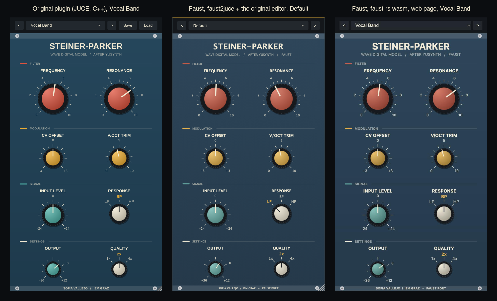

# faust-steiner-parker

**The Steiner-Parker filter of Sofia Vallejo, a nonlinear wave digital model of the Yusynth Steiner-Parker VCF, written in Faust, checked sample by sample against the plugin's own C++, and built as a JUCE plugin (faust2juce) and a web page (faust-rs, WebAssembly) with the original faceplate.**

*Version française : [README.fr.md](README.fr.md).*

The [original](https://github.com/sofiavallejob/steiner-parker-filter) (AGPL-3.0, Institute of Electronic Music and Acoustics, KUG Graz; [write-up](https://sofiavallejob.github.io/sofiavallejo/blog/steiner-parker-filter/)) models the Vult Eurorack build (L. Laguna Ruiz, 2017) of the Yusynth "improved" Steiner-Parker VCF, after Nyle Steiner's Synthacon. It comes as a Python reference, a C++ model (`plugin/Source/SPModel.h`, 319 lines) inside a JUCE plugin, and a Reaper JSFX:

- the six capacitors are wave digital leaves (Rc = T/2C, b[n] = a[n−1]);
- everything else, 11 nodes (the diode ladder, the THAT300 expo pair, the TL074 stages with a rail knee, the resonance loop), is one nonlinear root reduced to 5 ports, four merged diode groups and the feedback current, solved by Newton at every sample with SPICE junction limiting (`pnjlim`), the resonance loop inside the solve rather than broken by a delay;
- the state starts from the DC operating point; the plugin adds 5 ms control smoothing, 1x/2x/4x oversampling, an output stage (×22, rail knee) and 8 factory presets.

This repository is the same model in Faust, [dsp/steinerparker.lib](dsp/steinerparker.lib), and what it measured:

- **it reproduces the C++**: the circuit alone agrees with `SPModel.h` to 5e-8 V on jacks A and B and 2e-7 V on jack C (peaks 0.6 to 0.9 V), the whole plugin chain to −115 dB of the peak at worst over the default settings, the 8 factory presets and 1x/2x/4x; for comparison the original reports 0.8 µV between its C++ and its Python, 1.4 µV between its JSFX and its Python ([results/results.md](results/results.md));
- **it costs what the C++ costs**, compiled by faust-rs with a Newton loop that exits as the C++'s does: 27.1x real time in stereo at 2x against 26.4x for the original, 10.4x against 9.2x at 4x, same machine, compiler and flags (§4). The form any Faust compiler accepts, the loop unrolled to 12 iterations, is 3 to 4.6 times slower;
- the nodal matrices and their inverse are not precomputed: the Faust program builds the netlist and inverts it itself, by Gauss-Jordan written on buses, for the three jacks at the rate of the host, once at initialisation;
- **it runs as a JUCE plugin** (AU, VST3, Standalone) built by faust2juce with the original faceplate (the editor of the plugin, adapted to the Faust processor) and the 8 presets as host programs, and **as a web page** compiled to WebAssembly by faust-rs, the same faceplate in SVG, Quality switchable.

<p align="center"></p>

## Contents

1. [The port](#1-the-port)
2. [The two forms of the Newton loop](#2-the-two-forms-of-the-newton-loop)
3. [Results](#3-results)
4. [CPU cost](#4-cpu-cost)
5. [The JUCE plugin and the web page](#5-the-juce-plugin-and-the-web-page)
6. [Running it](#6-running-it)
7. [Why not `wdmodels.lib`](#7-why-not-wdmodelslib)
8. [What differs from the original](#8-what-differs-from-the-original)
9. [Files](#9-files)

## 1. The port

**Netlist.** `nodal(dest, fs)` writes the 11 × 11 conductance matrix of `Circuit::build`, reference designators kept, for the input jack `dest` (A low-pass, B band-pass, C high-pass), with the capacitor conductances 2 fs C stamped in; `fs = 0` leaves the capacitors open and gives the DC matrix. Every entry is a sum of stamps whose node indices are compile-time integers, so the structural zeros fold away.

**Inversion in the program.** `inverse(n)` is Gauss-Jordan on [A | I], `n` steps of `gj_step`, each a `route` that hands every element the four values it needs (a_ij, a_ik, a_kj, a_kk) and an arithmetic `par`: the program grows with the matrix (11 steps of 242 elements), not with the uses of its entries. No pivoting: the nodal matrix is symmetric and diagonally dominant. `coefs(dest, fs)` then forms the 165 coefficients of the root (K, Au, Ac and Wc of `Circuit::reduce` and `precompute`), each a bilinear form (e_a − e_b)ᵀ Gi (e_c − e_d) read from the inverse. They depend on `ma.SR` only, so the compiler computes them once at initialisation; the three jacks are computed and selected by the Response control (a mode change resets the state to the DC point, as the plugin's `reconfigure` does). They agree with the C++'s to 2e-14 relative.

**The root.** `newton_step` is one iteration on the 5 ports: diode currents linearised above 40 thermal voltages, the feedback current through the rail knee, F(u) = u − u0 + K i(u), J = I + K diag(i′(u)), the 5 × 5 system solved by Gauss-Jordan (the JSFX does not pivot either; the C++'s partial pivoting never swaps a row at any setting measured: removing it leaves its output bit-identical), `pnjlim` on the diode ports, and a freeze once a step is under 1e-9 V. `tick` is one sample: u0 = Au z with z = [1, vs, i1, i2, b], the Newton loop, the waves b ← 2 v − b, and Vo1 through the rail knee.

**The DC point.** `dc_state` runs the same tick on the DC coefficients, from u = (0.5, 0.5, 0.5, 0.5, 0), with 40 iterations (the C++ needs up to 32 over the control ranges); it depends on the controls only, so it is computed at control rate, and the state takes it on the first sample, on a change of jack, and whenever the state stops being finite.

**The plugin chain** is the original's: controls smoothed over 5 ms and applied once per host sample, 1.0 = 5 V at the jack, the inverting buffer IC1A, oversampling with the anti-aliasing filters of the JSFX (two RBJ biquads at 0.45 of the host rate on each side, the input on the first sub-sample), the output stage, the output gain.

## 2. The two forms of the Newton loop

The C++ iterates until a step is under 1e-9 V, at most 50 times: 2 iterations on 95 % of the samples, up to 13 at full resonance with +24 dB of drive. Faust has no loop, so the library takes the loop as an argument of `tick_with`:

- **`repeated(H)`**, the loop of the C++, exit included. It is built on [dsp/repeat.lib](dsp/repeat.lib) (from [faust-diff-ts808](../faust-diff-ts808)), the simulation of the `repeat` primitive by the `ondemand` clock domains of faust-rs: a sample costs the iterations it needs. faust-rs only (faustprobe, `faust-rs -lang cpp`, `-lang wasm`): `dsp/steinerparker_rs*.dsp`.
- **`unrolled(N)`**, for any Faust compiler (the C++ Faust compiler, hence faust2juce): N iterations computed at every sample, frozen once converged. The iterate is the C++'s as long as N covers what the sample needs; N = 12 is the smallest budget that reproduces the C++ at every setting measured (N = 3 already does at every normal setting; the screaming ones need 12). `dsp/steinerparker*.dsp`.

The two forms give the same samples (the largest difference between them over the whole suite is in the table of [results/results.md](results/results.md)); they differ only in what they cost.

## 3. Results

All in [results/results.md](results/results.md), written by `make test` with the command lines, the versions of every tool (faust-rs commit included) and the machine. Every Faust output is compared with the original model, `ref/SPModel.h` unchanged, driven by [ref/sp_ref.cpp](ref/sp_ref.cpp) (the circuit alone as the original's `model_test`, or the plugin chain of the JSFX).

- **Circuit alone**, a 110 Hz saw of 5 V at 192 kHz as in `model_test`, 0.125 s: 4.9e-8, 5.2e-8 and 1.9e-7 V on jacks A, B and C (peaks 0.63 to 0.90 V); jack C's grows with the slow offset described below.
- **Plugin chain**, a 55 Hz saw at 48 kHz, 2 s: −115 to −131 dB of the peak at the default settings at 1x/2x/4x, the band-pass and high-pass settings, the closed filter, the CV and trim extremes, and 7 of the 8 presets.
- **Where the agreement comes from.** The two DC points differ by about 1e-9 V (the DC matrix spans 1e-12 to 1e-3 S: GMIN on the floating nodes of the ladder), and that difference is already in the first sample. It is not the Newton tolerance (the C++ at 1e-9 and at 1e-13 differ by −201 dB) nor the pivoting.
- **A slow offset.** Neither DC point is exactly the equilibrium of its discrete system: with no input, each implementation moves away from its own by up to 2e-7 V on Vo1 within a few seconds (the slow pole of C12 and R14, 1.5 s), and they settle 1.6e-7 V (jack A) to 1.8e-7 V (jack C) apart at 48 kHz, with or without a signal: a DC offset at −135 dB of the signal. Its cause is not identified (it does not move with the Newton tolerance either); it grows with the sample rate (at 192 kHz it reaches 1e-6 V after a second, still rising), which is why the circuit check, 0.125 s at 192 kHz, allows 5e-7 V.
- **Chaotic settings.** The "Self-oscillation" preset (resonance 0.97, 4x) oscillates from rounding noise: the C++ itself moves by +6 dB when its input is scaled by 1 + 1e-9, and the two channels of the Faust program, fed the same input, differ as much. At full resonance with +24 dB of drive the differences grow too, more slowly. There the suite compares level and spectral centroid against the spread of the perturbed C++ runs, and the Faust program is within it.
- **The check rejects what it should**: changing R6 by 1 % in the Faust netlist fails 20 checks (−66 dB), changing it by 1 Ω (21 ppm) fails 5.
- **The other backends**: the C++ generated by the C++ Faust compiler and by faust-rs, and the wasm of the web page run under node by the page's own loader, agree with faustprobe to −114 dB or better.

## 4. CPU cost

Stereo, 48 kHz, a 55 Hz saw, default settings, the compute call alone timed, best of three runs; the C++ programs built with Apple clang 21 `-O3 -ffp-contract=off`, Apple M5 ([results/results.md](results/results.md), `make cost`):

| quality | C++ original | Faust, faust-rs C++, `repeated` | Faust, faust-rs C++, `unrolled(12)` | Faust, faust (C++) C++, `unrolled(12)` | Faust, wasm (node) | Faust, faustprobe JIT, `repeated` |
|---|---|---|---|---|---|---|
| 1x | 52.4x | 53.7x | 11.3x | 11.2x | 19.3x | 25.8x |
| 2x | 26.4x | 27.1x | 5.7x | 6.1x | 10.2x | 13.5x |
| 4x | 9.2x | 10.4x | 2.9x | 3.0x | 4.4x | 5.4x |

(real-time factors; the original's write-up reports "about 7 times faster than real time" at 2x in stereo on its machine.)

- With the loop that exits, the Faust program costs what the C++ costs: 1.02x its speed at 1x, 1.03x at 2x, 1.13x at 4x (single runs of the same program differ by 10 to 20 %: hence the best of three).
- The unrolled form pays 12 iterations where the C++ pays 2 to 3: 3 to 4.6 times the cost. That is the price of faust2juce today, since the C++ Faust compiler has neither `ondemand` nor `repeat`.
- In the browser (the pane of the Claude desktop app, Chromium), the AudioWorklet measures 8.8 % of the audio time at 2x and 48 kHz, 21.7 % at 4x.

## 5. The JUCE plugin and the web page

**JUCE.** `make juce` runs faust2juce with `-presets juce/presets.json` (the 8 factory presets as host programs, after the "Default" entry of the architecture) and builds the generated CMake project with `-DFAUST_CUSTOM_EDITOR=juce/SteinerParkerEditor.h`: the faceplate of the original plugin, its look and feel, knobs, scales, colours and layout taken from `PluginEditor.{h,cpp}` and bound to the host parameters of the Faust processor. Quality is fixed when a Faust program is compiled, so the plugin shows the factor it was built with (`make juce QUALITY=4` builds the 4x one) and the Quality selector does not turn; Save/Load of preset files is left out. CMake downloads JUCE 8.0.10 the first time (the editor needs JUCE 8).

**Web.** `make web` compiles `dsp/steinerparker_rs{,_1x,_4x}.dsp` to wasm (double precision) by faust-rs, and [web/](web/) plays them in an AudioWorklet: the faceplate drawn in SVG with the original's geometry and colours (drag, wheel, arrow keys, double click to reset, clickable selector labels), the preset bar, and a test bench (a saw at 1.0 = 5 V, noise, an audio file or the microphone, the slow cutoff sweep of the write-up's listening examples, a CPU meter). Quality switches between the three programs and restarts the state at the DC point, as the plugin does. `make web-serve`, then <http://localhost:8765/web/>.

## 6. Running it

```sh
make test         # every check and the CPU cost: results/results.md (about fifteen minutes)
make quick        # the checks on shorter renders, no timing (about two minutes)
make check        # every program compiles (faustprobe; the unrolled ones with faust too)
make cost         # the CPU cost alone
make web          # web/dsp/*.wasm
make web-serve    # http://localhost:8765/web/
make juce         # build/juce/steinerparker-2x/build/steinerparker_artefacts/Release/{AU,VST3,Standalone}
```

Requirements: a [faust-rs](https://github.com/grame-cncm/faust-rs) checkout next to this one (`FAUST_RS=...` otherwise) with release `faustprobe` and `faust-rs` built (`cargo build --release -p cranelift-ffi --bin faustprobe`, `cargo build --release -p compiler --bin faust-rs`); the C++ Faust compiler with `faust2juce` for the JUCE plugin; python3 with numpy; node for the wasm check; CMake and Ninja for JUCE.

In another program:

```faust
sp = library("steinerparker.lib");
process = sp.plugin(2, 12, 40);                    // any Faust compiler
process = sp.plugin_with(2, sp.repeated(50), 40);  // faust-rs: the loop exits
```

Compile in double precision (`-double`): the DC system spans nine decades of conductance and the Newton tolerance is 1e-9 V.

## 7. Why not `wdmodels.lib`

The Faust libraries' [wdmodels.lib](https://github.com/grame-cncm/faustlibraries/blob/master/wdmodels.lib) builds wave digital filters as connection trees of adaptors, with at most one unadapted element at the root, solved in closed form or by a scalar iteration (a diode pair through the Wright omega function), and R-type adaptors from a scattering matrix the user supplies. This model is outside that frame:

- the root has **five** nonlinear ports coupled through an 11-node network (four diode groups and a controlled feedback current), solved together by a 5-dimensional Newton with junction limiting: not a one-port nonlinearity at the root of a tree;
- its linear part is not given as a scattering matrix: it is the inverse of the nodal matrix with the capacitor conductances in it, which depends on the sample rate and on the input jack; computing it is most of the work, and the library does it in the program;
- the state must start at the DC operating point (C7 is 47 µF: from zero the filter would spend tens of milliseconds settling, and could not be compared with the C++ sample by sample); `wdmodels.lib`'s elements start from zero.

What it could carry, the six capacitor leaves (b[n] = a[n−1]), is two lines of the `tick` here. A simplified Steiner-Parker, one diode nonlinearity at the root of a tree of adaptors, would be a natural `wdmodels.lib` program, but it would be a different model from the one this repository reproduces.

## 8. What differs from the original

- **Oversampling filters**: the JUCE plugin uses JUCE's polyphase IIR half-band oversampler; this port, and its reference renderer, use the JSFX's filters (two biquads on each side). The Faust program is compared with that chain.
- **Quality** is a compile-time choice in Faust: three programs, switched by the web page; fixed in a faust2juce build.
- **Newton**: no pivoting in the 5 × 5 solve (never used by the C++); in the unrolled form, at most 12 iterations.
- **Recovery**: the Faust program resets its state to the DC point as soon as the state is not finite, on the sample; the C++ plugin clears the block and reconfigures.
- **Not ported**: preset files (Save/Load), the JSFX's mono-sum option, single precision.

## 9. Files

| file | |
|---|---|
| [dsp/steinerparker.lib](dsp/steinerparker.lib) | the model: bus helpers (Gauss-Jordan, solve, matvec), netlist, coefficients, Newton (two forms), DC point, controls, plugin chain |
| [dsp/steinerparker.dsp](dsp/steinerparker.dsp), `_1x`, `_4x` | the plugin, Newton unrolled (any Faust compiler, faust2juce) |
| [dsp/steinerparker_rs.dsp](dsp/steinerparker_rs.dsp), `_1x`, `_4x` | the plugin, Newton with an exit (faust-rs, web) |
| [dsp/sp_core.dsp](dsp/sp_core.dsp) | the circuit alone, as the original's `model_test` |
| [dsp/repeat.lib](dsp/repeat.lib) | the `repeat` loop on `ondemand`, from faust-diff-ts808 (MIT) |
| [ref/SPModel.h](ref/SPModel.h) | the original C++ model, unchanged (AGPL-3.0, commit `ed91b4ab` of 2026-11-04) |
| [ref/sp_ref.cpp](ref/sp_ref.cpp) | renderer of the original: circuit alone, plugin chain, timing |
| [scripts/test_sp.py](scripts/test_sp.py) | every check; writes [results/results.md](results/results.md) |
| [scripts/web_check.mjs](scripts/web_check.mjs) | the wasm under node: render, timing |
| [tools/bench_arch.cpp](tools/bench_arch.cpp) | architecture file for the timing and rendering of generated C++ |
| [juce/SteinerParkerEditor.h](juce/SteinerParkerEditor.h), [juce/presets.json](juce/presets.json) | the faceplate and the presets of the faust2juce build |
| [web/](web/) | the web page: faceplate, AudioWorklet, the faust-rs wasm loader from faust-elements |

## License

AGPL-3.0-only, as the original ([LICENSE](LICENSE)): the model, its netlist and values, the presets and the faceplate are Sofia Vallejo's (2026); circuit after Yves Usson (Yusynth) and Leonardo Laguna Ruiz (Vult), originally Nyle Steiner. `dsp/repeat.lib` (MIT) comes from faust-diff-ts808, `web/faust-wasm-dsp.js` (MIT) from faust-elements.
